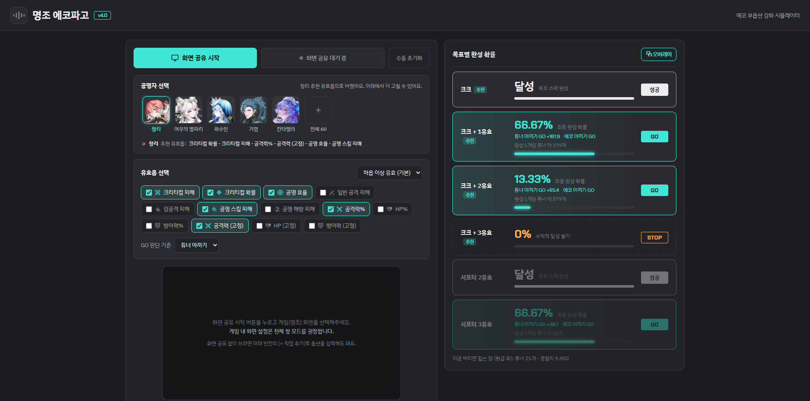
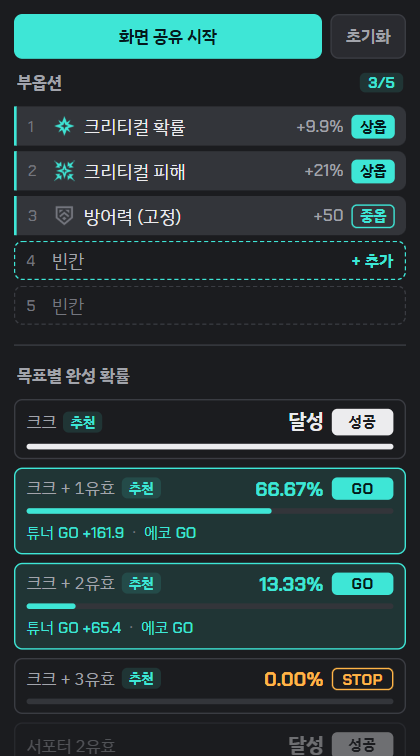

<div align="center">

# 명조 에코파고

**명조: 워더링 웨이브 에코 부옵션 강화 시뮬레이터**

게임 화면을 공유하면 부옵션을 실시간으로 읽고,<br>
목표 스펙까지의 **완성 확률**과 **튜너 손익**으로 계속 강화할지(**GO / STOP**) 알려줍니다.

[](https://crexont.github.io/wuwa-echo-helper/)
&nbsp;




</div>

## 이런 걸 해줘요

- **화면 공유로 자동 인식**: 에코 강화 화면을 공유하면 열린 부옵션 5칸을 OCR로 읽어요. 강화할 때마다 새로 열린 줄만 골라서 다시 읽어요.
- **목표별 완성 확률**: 크크, 크크 + 1·2·3유효, 서포터 2·3유효 목표마다 남은 칸으로 목표를 채울 확률을 정확히 계산해요.
- **GO / STOP 판정** (v4.0): 두 가지 기준으로 같이 계산해요.
  - **튜너 아끼기** (기본): 지금 버리고 새 에코로 가는 것과 계속 강화하는 것 중, 완성 1개당 드는 튜너가 더 적은 쪽을 골라요.
  - **에코 아끼기**: 목표 완성이 불가능해질 때만 STOP이에요.
- **공명자 선택** (v4.0): 캐릭터를 고르면 그 캐릭터의 유효옵이 자동으로 체크되고(추천 유효옵은 얼굴 줄 아래에 표시), 딜러는 크크 목표, 서포터는 서포터 목표를 추천해요. 60명(방랑자는 속성별), 검색·속성 필터 지원.
- **유효옵·수치 컷 설정**: 캐릭터에 맞게 유효옵을 고르고, 하옵/중옵/상옵 이상만 유효로 칠 수도 있어요.
- **오버레이 창** (v3.0): 게임 위에 항상 떠 있는 작은 창에서 부옵션과 확률을 보고, 공유·초기화·직접 추가까지 할 수 있어요.
- **직접 입력**: 화면 공유가 안 되는 모바일에서도 빈칸을 눌러 옵션을 입력하면 똑같이 계산해요.

## 사용법

1. [사이트](https://crexont.github.io/wuwa-echo-helper/)에 들어가서 **화면 공유 시작**을 누르고 명조 창을 선택해요.
   (게임은 **전체 창 모드**를 권장해요.)
2. **공명자 선택**에서 키우는 캐릭터를 고르면 유효옵이 자동으로 체크돼요. 필요하면 **유효옵 선택**에서 직접 고쳐도 돼요.
   **GO 판단 기준**은 튜너 아끼기(기본)와 에코 아끼기 중에 골라요.
3. 게임에서 에코 강화 화면을 열고 강화하면, 오른쪽에 목표별 확률과 GO / STOP이 떠요.
4. 인식 위치가 안 맞으면 **영역 조정**으로 박스를 맞춰 주세요.
5. 잘못 읽은 칸은 눌러서 고치면 📌 고정돼요.
6. 게임 위에 띄워 두고 싶으면 **⧉ 오버레이**를 눌러요. (크롬·엣지 PC)

<div align="center">
  <br>
  <sub>오버레이 창: 게임 위에 띄워 두고 부옵션과 확률을 바로 확인</sub>
</div>

## 확률 계산 방식

- 부옵션은 13종 중에서 **중복 없이 균등하게** 5칸이 뽑힌다고 봐요.
- 수치 단계 확률은 아래 표를 써요. (사이트의 **부옵션 수치 확률표**에서도 볼 수 있어요.)

| 계열 | 단계별 확률 |
|---|---|
| 크리티컬 확률·피해 (8단계) | 23.33 / 23.33 / 23.33 / 8 / 8 / 8 / 3 / 3 % |
| 일반 % · HP 고정 (8단계) | 6.80 / 7.77 / 20.39 / 24.27 / 17.48 / 14.56 / 5.83 / 2.91 % |
| 공격력 고정 (4단계) | 6.80 / 52.43 / 37.86 / 2.91 % |
| 방어력 고정 (4단계) | 14.56 / 44.66 / 32.04 / 8.74 % |

- 단계별 등급은 이렇게 나눠요.

| 등급 | 8단계 계열 | 4단계 (고정치) |
|---|---|---|
| 상옵 | 7, 8단계 | 4단계 |
| 중옵 | 4, 5, 6단계 | 2, 3단계 |
| 하옵 | 1, 2, 3단계 | 1단계 |

- 남은 칸의 모든 경우를 정확히 세서 계산해요. 몬테카를로 시뮬레이션과 비교해 오차 0.12%p 이내로 확인했어요.

### 튜너 손익분기 (v4.0)

| 항목 | 값 |
|---|---|
| 부옵션 칸 하나 열 때 | 튜너 10개 (5성 에코, 레벨 5 · 10 · 15 · 20 · 25) |
| 칸 열기 전 필요한 경험치 | 4,400 / 12,100 / 23,100 / 39,500 / 63,500 |
| 재료로 쓰면 돌려받는 양 | 튜너 30%, 경험치 75% |

- 새 에코부터 끝까지 가장 좋은 판단으로 강화했을 때 **완성 1개당 기대 튜너**를 먼저 구하고, 지금 상태에서 다음 칸을 열었을 때의 기대 손익이 +면 GO, -면 STOP이에요.
- 그 판단대로 에코를 30만 개 강화해 본 시뮬레이션과 비교해, 완성 1개당 튜너가 오차 3% 이내로 맞는 것을 확인했어요.

## 개인정보

- 화면 인식(OCR)은 전부 **내 브라우저 안에서** 돌아가요. 게임 화면은 어디에도 전송되지 않아요.
- 설정(유효옵, GO 판단 기준, 고른 공명자, 인식 영역)만 브라우저 저장소에 남아요.

## 파일 구조

| 파일 | 역할 |
|---|---|
| `index.html` · `style.css` | 화면 구성과 디자인 |
| `app.js` | 전체 흐름, 화면 그리기, 설정 저장 |
| `scan.js` | 바뀐 줄을 찾아서 읽을 순서 정하기 |
| `ocr.js` | 전처리, Tesseract.js 인식, 모양 기억(재인식 생략) |
| `math.js` | 목표별 완성 확률, 튜너 손익분기 계산 |
| `data.js` | 부옵션 종류·수치표·목표 정의 |
| `overlay.js` | 오버레이 창 (Document Picture-in-Picture) |
| `roles.js` · `presets.js` | 공명자 선택, 공명자별 유효옵 |
| `img/roles/` · `icons/elements/` | 공명자 얼굴 아이콘, 속성 아이콘 |
| `config.js` | 공통 설정값 |

빌드 과정 없이 순수 HTML·CSS·JS(ES 모듈)로 되어 있어요. 로컬에서는 아무 정적 서버로 열면 돼요.

```bash
npx serve .
```

## 관련 글 (아카라이브 명조 채널)

- [명조 에코파고 사용 가이드](https://arca.live/b/wutheringwaves/185606428)
- [패치노트 v4.0](https://arca.live/b/wutheringwaves/186203926)
- [패치노트 v3.0](https://arca.live/b/wutheringwaves/186069329)
- [패치노트 v2.0](https://arca.live/b/wutheringwaves/185575199)
- [패치노트 v1.0](https://arca.live/b/wutheringwaves/183103882)

## 라이선스

© 2026 crexont. All rights reserved.

사이트는 누구나 자유롭게 써도 되고, 코드는 공부 목적으로 읽어봐도 괜찮아요.
다만 **허락 없이 코드를 복제·수정·재배포하거나, 다른 이름으로 다시 올리는 건 금지**예요. 자세한 내용은 [LICENSE](LICENSE)를 봐 주세요.

---

<sub>수익을 목적으로 하지 않는 비영리·비공식 팬 도구입니다. 게임 리소스(아이콘 등)와 상표의 권리는 Kuro Games에 있습니다.</sub>
